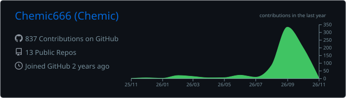
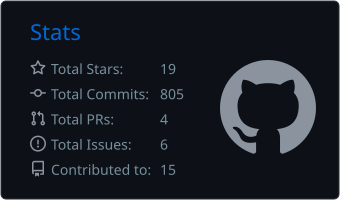
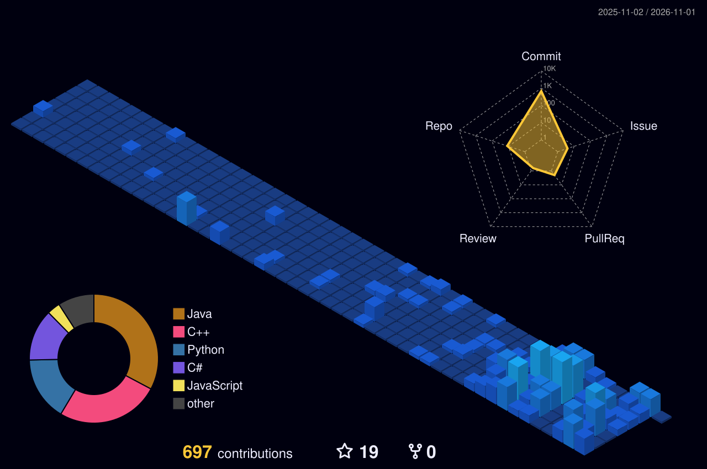
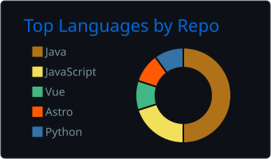
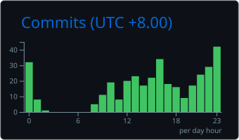

<div align="center">

<sub><b>SOFTWARE ENGINEERING / BACKEND SYSTEMS / AI TOOLING</b></sub>

# CHEMIC<span>_</span>

**Building software worth understanding — and worth using.**


<br>

<a href="https://github.com/Chemic666?tab=followers"></a>
<a href="https://github.com/Chemic666?tab=repositories"></a>


<br><br>

<a href="https://github.com/Chemic666?tab=repositories&sort=updated">PROJECTS</a>
&nbsp;·&nbsp;
<a href="https://github.com/Chemic666?tab=overview">ACTIVITY</a>
&nbsp;·&nbsp;
<a href="https://github.com/pulls?q=is%3Apr+author%3AChemic666">PULL REQUESTS</a>

</div>

---

### `01 // THE PERSON BEHIND THE COMMITS`

I'm **Chemic**, a software engineering undergraduate exploring the intersection of **backend engineering**, **AI-assisted development**, and **developer experience**.

I care about more than making a framework work. I want to understand the architecture, the trade-offs, the failure modes, and how to make software more reliable.

```yaml
identity: Chemic
github: Chemic666
interests:
  - Java & backend architecture
  - AI agents & developer productivity
  - Software testing & program analysis
  - Open source and practical tools
approach: "Learn → Understand → Build → Verify → Iterate"
```

### `02 // TOOLKIT`

<div align="center">


<br>

<sub>Java · Spring Boot · MyBatis · MySQL · Docker · Git · AI Agents · Automation</sub>

</div>

---

### `03 // LIVE GITHUB SIGNALS`

<div align="center">

<!-- Generated by .github/workflows/metrics.yml and stored in this repository -->


<table>
<tr>
<td width="50%">

</td>
<td width="50%">

</td>
</tr>
</table>

<picture>
  <source media="(prefers-color-scheme: dark)" srcset="./profile/streak-dark.svg">
  <source media="(prefers-color-scheme: light)" srcset="./profile/streak-light.svg">
  
</picture>

</div>

---

### `04 // CONTRIBUTION LANDSCAPE`

<div align="center">

**A year of code, seen from another angle.**

<!-- Generated by .github/workflows/3d-contrib.yml -->


<!-- Generated by .github/workflows/snake.yml to the output branch -->
<picture>
  <source media="(prefers-color-scheme: dark)" srcset="https://raw.githubusercontent.com/Chemic666/Chemic666/output/github-contribution-grid-snake-dark.svg">
  <source media="(prefers-color-scheme: light)" srcset="https://raw.githubusercontent.com/Chemic666/Chemic666/output/github-contribution-grid-snake.svg">
  
</picture>

</div>

---

### `05 // SELECTED WORK`

> A few things I'm building and learning from. For the actual latest activity, follow each repository.

<table>
<tr>
<td width="50%" valign="top">

**[YanJi / 研迹](https://github.com/Chemic666/yanji)**

Local-first Windows study planning, focus tracking, and progress visualization.


</td>
<td width="50%" valign="top">

**[RepoOnboard](https://github.com/Chemic666/RepoOnboard)**

Codebase comprehension and onboarding for Java and Spring Boot repositories.


</td>
</tr>
<tr>
<td width="50%" valign="top">

**[AI Project Visualizer](https://github.com/Chemic666/ai-project-visualizer)**

An exploration of making AI-assisted project work more observable.


</td>
<td width="50%" valign="top">

**[KnowledgeAgent](https://github.com/Chemic666/KnowledgeAgent)**

Retrieval-augmented knowledge assistance with an emphasis on traceable answers.


</td>
</tr>
</table>

<div align="center">

**[VIEW ALL REPOSITORIES →](https://github.com/Chemic666?tab=repositories&sort=updated)**

</div>

---

### `06 // HOW I ENGINEER`

| Principle | Practice |
|:--|:--|
| **Understand before abstracting** | Learn the mechanisms beneath the APIs. |
| **Evidence over guesswork** | Debug with observations and reproducible tests. |
| **Practical over complicated** | Keep systems understandable and maintainable. |
| **Ship, then improve** | Working software is the starting point, not the finish line. |

<details>
<summary><b>More activity metrics</b></summary>
<br>

<div align="center">


</div>

</details>

---

<div align="center">

<sub>CODE IS THE MEDIUM. UNDERSTANDING IS THE GOAL.</sub>

<br>

**BUILD SOMETHING WORTH USING.**

<sub>Profile graphics are generated automatically by GitHub Actions; no manual image uploads required.</sub>

</div>
